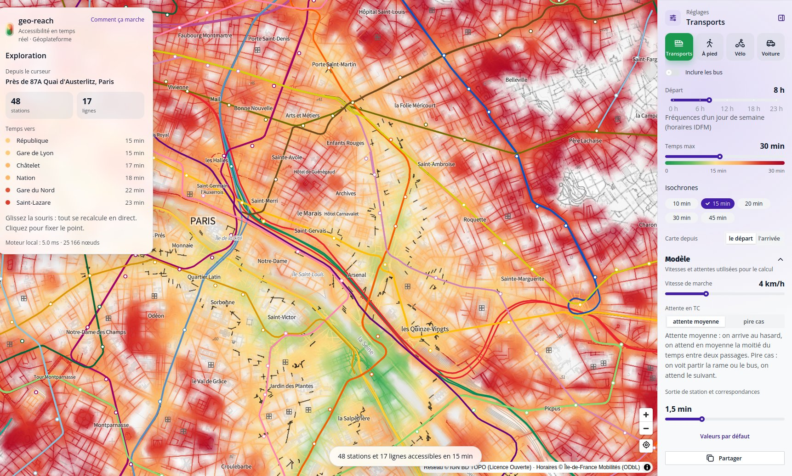

# geo-reach

### How far can you go in 15 minutes, from anywhere in France?

Move the mouse: travel times to the whole region in view are recomputed **at every move**, on foot, by bike, by car or by
public transport, and the map lights up from green (close) to red (far).

**[▶ Open the demo](https://ignf.github.io/geo-reach/)** · [How it works](https://ignf.github.io/geo-reach/how-it-works.html)
· desktop browser recommended

[](https://ignf.github.io/geo-reach/)

| 13 | 18 M | 14,000 | 0 |
|:---:|:---:|:---:|:---:|
| regions of metropolitan France | road sections | public transport lines | server: everything runs in your browser |

- **Géoplateforme data** (IGN): BD TOPO road network and buildings, Plan IGN basemap, hillshade, geocoding; public
  transport timetables from transport.data.gouv.fr (Île-de-France Mobilités, regional aggregates, SNCF).
- **A Rust engine compiled to WebAssembly**, in a background thread: the whole region in a few tens of milliseconds
  at most, where a routing server would need seconds per map.

## What you can do

- **Search an address or a place** (top left): the Géoplateforme suggests addresses, stations, monuments and towns
  while you type; the map goes there, loading its region if it is elsewhere in France.
- **Hover anywhere**: the map is recolored by travel time from the cursor, at every mouse move.
- **Click to pin a point**: then hover a destination to see the time, the route drawn on the map and the trip
  step by step (streets, waits, metro or bus lines).
- **See it in 3D** (the default view): the map is tilted and the BD TOPO buildings stand up, each colored by its
  travel time and following the cursor like the streets; "2D" flattens it. The 45° button of the map controls tilts
  or flattens it too.
- **Choose how you travel**: walk, bike, car or public transport (metro, RER, tram, with or without buses).
- **Choose the time of departure**: car times follow a typical weekday traffic curve, transit times follow the
  real service frequency at that hour.
- **Departure or arrival**: "where can I go from here" or "where can people come from to reach this point".
- **Travel time up to**: one duration for the colors and the figures, with contour lines every 10 or 15 min.
- **Scenarios**: disrupted transit (fewer departures, slower rides) or congested roads, as what-if coefficients.
- **Simulate a closure**: "Simulate a closure", then a click on a metro, RER or tram section or on a street closes
  it; the whole map is recomputed around it, and the panel counts the stations within reach that lose more than
  5 min (e.g. line 1 closed between Château de Vincennes and Bérault: Nation goes from 10 to 18 min, by the RER A).
  "Default values" reopens everything.
- **Compare the modes**: with a pinned point, the same trip on foot, by bike, by car and by public transport, side by
  side once the cursor stops (a worker of its own); a click shows the map of that mode.
- **Adjust the calculation**: walking and cycling speed, traffic, average or worst-case wait, transfer time.
- **Read the figures**: stations and lines you can board, nearest station, cycle lanes, travel times to well-known
  places (Châtelet, Gare de Lyon, La Défense…).
- **Share**: the link keeps the whole view (mode, hour, point, settings).

The interface is in French or English, following the browser language.

## How accurate is it?

It is a proof of concept, good for comparing places and modes, not for planning a trip to the minute:

- **Transit**: average waits (half the time between two trains or buses at that hour) on a typical weekday, not the
  exact timetable; changes happen inside the station.
- **Car**: estimated traffic from a typical congestion curve, no live traffic, no traffic lights.
- **Walk**: 4 km/h on the flat, as the Géoplateforme route service. **Bike**: 15 km/h, a little faster on cycle lanes.
- **Slopes**: walking and cycling slow down uphill (Tobler's hiking function for walking), using the heights of the
  BD TOPO roads. The Géoplateforme route service ignores them, so its walking times differ on hills.
- **Zone**: the 13 regions of metropolitan France, one network each. The region follows the map: move the view into
  another region (or use "My location") and its network loads in the background, the map staying where it is. Full street network in the main city centres; beyond, no footpaths, tracks nor service roads (main
  roads, streets and station access are kept). Public transport in every region: the
  regional GTFS aggregate where there is one (seven regions), elsewhere the SNCF trains merged with the main urban
  networks (Lille, Marseille, Nice, Toulouse, Montpellier, Dijon…) and the regional coaches; Île-de-France
  Mobilités in Île-de-France. Details by region: [web/public/data/README.md](web/public/data/README.md).

The first visit downloads the network of the region in view (2 to 54 MB compressed, 18 MB for Île-de-France); the browser then keeps it, so later visits load
locally.

When the cursor stops, walking and driving times are checked against the Géoplateforme route service, shown in the
trip panel.

## Why not call the Géoplateforme route service directly?

The first version did: on each click, it asked the Géoplateforme for a series of isochrones (12 to 15) and merged
them into a map. One map took 1.2 s on foot and 2.7 s by car, and the service accepts about 5 requests per second.
Following the mouse needs a new map at every screen refresh, 30 to 60 per second: about a hundred times more. The
route service is made to answer route requests, not to feed an interactive map, and it has no public transport.

So the **data** comes from the Géoplateforme and the **computation** runs in the browser:

- the road network is the BD TOPO, read from the Géoplateforme WFS; the basemap is Plan IGN; addresses come from
  its reverse geocoding;
- the route service stays the reference: when the cursor stops, its walking or driving time is shown beside ours
  in the trip panel. Walking uses the same speed on the flat (4 km/h); night driving times differ by about 15 %
  (`scripts/calibrate.ts --gpf`).

What would let the Géoplateforme serve this directly: a one-to-many service (a matrix of travel times, or
isochrones as a grid), or a downloadable routing graph.

## Legal notice

Published by the Institut national de l'information géographique et forestière (IGN), 73 avenue de Paris, 94160
Saint-Mandé, France; hosted by GitHub Pages. A proof of concept, not an official IGN service. No account, no cookie,
no audience measurement; the coordinates of the points looked at go to the Géoplateforme for addresses and route
comparison. Full text: [legal notice](https://ignf.github.io/geo-reach/legal.html).

## Data and licences

| Data | Source | Licence |
|---|---|---|
| Road network and buildings (BD TOPO), basemap (Plan IGN), hillshade (RGE ALTI) | IGN, Géoplateforme | Licence Ouverte Etalab 2.0 |
| Addresses near a point | Géoplateforme reverse geocoding | Licence Ouverte Etalab 2.0 |
| Public transport timetables | [Île-de-France Mobilités](https://transport.data.gouv.fr/datasets/reseaux-urbains-et-interurbains-dile-de-france-mobilites-idfm), regional aggregates and SNCF feed on [transport.data.gouv.fr](https://transport.data.gouv.fr) | per feed, mostly ODbL or Licence Ouverte |

The transit files are databases derived from these timetables, under the licence of their feed. Region by region:
[web/public/data/README.md](web/public/data/README.md).

## For developers

### Run it locally

Requirements: [Bun](https://bun.sh). Rust is only needed to change the engine (see below).

```sh
bun install
bun run dev        # http://127.0.0.1:5173
bun run build      # static site in web/dist
bun run typecheck  # strict TypeScript: the app and the scripts
bun run lint       # also: explicit types on exports, const over let, no `../` imports
```

Imports inside the app go through the `@/` alias (`@/engine/network` for `web/src/features/routing/network.ts`), set in
`web/tsconfig.app.json`, `web/vite.config.ts`, and `web/tsconfig.json` + `scripts/tsconfig.json` for Bun.

The prepared data (`web/public/data/*.bin`) and the compiled engine (`web/src/features/routing/engine.wasm`) are in
the repository: no data download, no Rust needed to run the app.

### How it works, in short

1. **Once, offline**: the BD TOPO roads (Géoplateforme WFS) and the IDFM timetables are packed into two compact
   binary files.
2. **At every mouse move**: the cursor is attached to the nearest street, then a shortest path engine written in
   Rust and compiled to WebAssembly computes the time to the whole network, in a background thread (Web Worker) so
   that the map never freezes.
3. **Drawing**: a WebGL layer on top of the MapLibre map colors every street on the graphics card; only the new
   times are sent at each move. The isochrone lines are traced on a 150 m grid from the reached streets and transit
   lines.
4. **3D buildings**: a worker extrudes the BD TOPO buildings of the Géoplateforme vector tiles; each one is joined
   to its nearest street, and the graphics card colors it from the same times as the streets, at every move.
5. **Closures** (what-if): the closed edges become impassable; a second worker runs the same computation with
   everything open, and the two are compared station by station.

The same explanation, with an interactive diagram: [How it works](https://ignf.github.io/geo-reach/how-it-works.html).

Details: [architecture](docs/architecture.md), [engine](docs/engine.md), [rendering](docs/rendering.md),
[data formats](docs/data-formats.md).

### Layout

```
web/                 React + MapLibre app (Vite), UI built with @ign-junn/design-system
  src/app/           entry point, root component, view state in the URL
  src/features/      one folder per feature (routing, map, buildings, cuts, trip, settings, search, regions),
                     reached through its index.ts
  src/shared/        generic code (config, formatting, WebGL helpers, Géoplateforme client, ui/)
  src/pages/         how it works, legal notice
crates/engine/       travel time engine in Rust, compiled to WebAssembly
crates/gtfs-prep/    Rust tool: GTFS timetables → public transport layer of a region
scripts/             region networks (roads, public transport), engine build
web/public/data/     the network files, one pair per region (see its README)
docs/                technical documentation
```

A *crate* is a Rust package (the equivalent of an npm package).

### Change the engine

Install Rust and the WebAssembly target:

```sh
rustup target add wasm32-unknown-unknown
bun run engine     # also run by `bun run dev` and `bun run build` when cargo is found
cargo test --workspace
cargo clippy --workspace --all-targets   # pedantic lints, set in Cargo.toml
```

### Rebuild the data

```sh
bun run data -- bretagne         # BD TOPO roads of a region → web/public/data/regions/bretagne.bin.gz
bun run transit -- bretagne      # its public transport → regions/bretagne.transit.bin.gz (needs cargo)
bun run transit -- all           # every region's public transport
```

Without an id, `bun run data` builds Île-de-France. Every region follows the same scheme, Île-de-France included.

The regions are listed in `web/src/features/regions/regions.ts` (box, opening point), the city centres kept in full in
`scripts/denseAreas.ts`, the reference day of the timetables in `crates/gtfs-prep`. Away from the city centres the
WFS filters the paths and service roads out itself; a region takes about a minute (one to three million sections).
The GTFS feeds are listed in `scripts/transitFeeds.ts` and cached in `.cache/gtfs/`. The region files are stored
gzipped (1 to 52 MB each, under the 100 MB a file of GitHub); the browser inflates them.

### Deployment

Every push to `main` builds the app and publishes it on GitHub Pages (`.github/workflows/pages.yml`).
