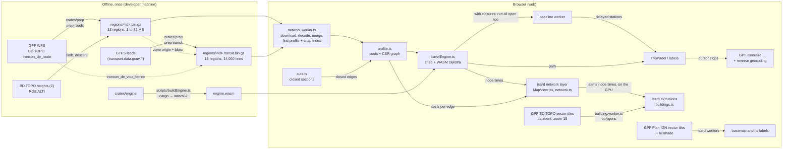
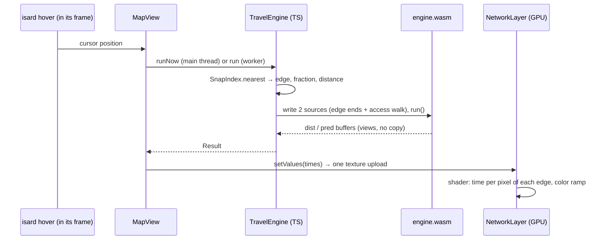

# Architecture

geo-reach is a static web app: no backend, no server-side computation. Everything that reacts to the mouse runs in
the browser, from data prepared once at build time. The only network calls after the first load are the basemap
tiles and two optional Géoplateforme queries made when the cursor stops (route comparison, reverse geocoding).

## The big picture



## Layout

The app follows a feature-based layout: each feature holds its components, its logic and its workers, and the rest
of the app reaches it only through its public API (`features/<name>/index.ts`, enforced by the linter). Within a
feature, files import each other relatively; across features, through `@/features/<name>`; generic code lives in
`shared/`. Dependencies run one way: `app` → features → `routing` and `shared`, with no cycle.

```
web/src/
  app/                  entry point, root component (App.tsx), global styles, view state in the URL
  features/
    routing/            networks (read, grafted), per-mode profiles, snapping, the WASM engine and its workers
    map/                the isard map and its layers, the network as its network layer takes it, camera
    buildings/          3D buildings: tiles read in a worker, extruded by isard, colored by the node times
    cuts/               closed sections: model, map layer, panel
    trip/               trip panel, legs, mode comparison, Géoplateforme route and addresses
    settings/           settings panel, mode picker, model of the travel times
    search/             address search
    regions/            the 13 regions (boxes, and outlines in shapes.json to tell which one a point is in, by
                        scripts/regionShapes.ts), startup (a worker downloads and decodes, then the engine) and its screen
  shared/               config, formatting, colors, projection, bounds, node times for the map (gl.ts), binary reader, data cache,
                        Géoplateforme client, ui/ (Brand, LineBadge)
  pages/                how-it-works/ (diagram, step details, made-up town running TravelEngine), legal/
  locales/              UI strings (English, French), picked from the browser language
```

Workers are named `*.worker.ts`. The UI is built with `@ign-junn/design-system` (`Box`, `Stack`, `Grid`,
`Typography`…); plain HTML only where it has no equivalent (map controls and markers, colors computed from the data).

| Path | Language | Role |
|---|---|---|
| `crates/prep` | Rust (native) | `prep roads`: downloads the BD TOPO road sections of a region from the GPF WFS and writes its road file; `prep transit`: downloads its GTFS feeds and writes its transit file, aligned on the origin of its road file |
| `crates/engine` | Rust → WebAssembly | Bounded multi-source Dijkstra, ~180 lines, no dependencies |
| `scripts/buildEngine.ts` | TypeScript (Bun) | `cargo build --target wasm32-unknown-unknown`, copies the result to `web/src/features/routing/engine.wasm` |

Two workspaces sit side by side: Bun for JavaScript (`package.json`, `web`) and Cargo for Rust (`Cargo.toml`,
`crates/*`). A *crate* is a Rust package.

## Why it is fast

The design goal is "no network call on mouse move". Each piece removes one cost from the hot path:

| Cost | Removed by |
|---|---|
| Routing server round trip (300–500 ms per GPF isochrone) | Local graph + WASM Dijkstra (~1–6 ms) |
| JSON parsing of the network | Binary files read as typed array views (zero copy) |
| Allocation per run | Buffers allocated once in WASM memory, reset lazily (only the nodes touched last time) |
| Copying results out of WASM | JS reads `dist` / `pred_*` as views on the WASM memory |
| Re-uploading geometry to the GPU | Geometry uploaded once per region, costs once per profile; each move uploads only the node times (one float per node) |
| Running more than once per frame | One run at a time: moves made meanwhile collapse into one run from the latest position |
| Drawing the times a frame late | isard calls the hover listener in its frame, before drawing: a short run made there is drawn by that frame |
| React re-renders at 60 Hz | Map label and route are updated imperatively; React panels are throttled |

## Hot path: one mouse move



When a point is pinned (click), the engine runs once from that point and the result is copied (`TravelEngine.pin`).
Mouse moves then only call `timeAt` (snap + two additions) and `path` (walk back the predecessors): no Dijkstra at
all. After `SETTLE_MS` without movement, `useGpfRoute` asks the Géoplateforme route service for the same trip
(walking and driving only: the GPF has no transit nor bike profile), with an `AbortController` so that only the latest request survives.

## Modes and directions

A *profile* (`web/src/features/routing/profile.ts`) is one combination of mode (`pedestrian`, `bike`, `car`,
`transit`), direction (`departure`, `arrival`), hour of departure (traffic, service frequency) and bus on/off. Switching profile rebuilds the cost arrays and the CSR graph in
JS (a few tens of ms), writes them into the WASM memory, and sends the new costs to the network layer (its geometry
stays on the graphics card). Snap indexes are cached per
mode.

- **Departure**: times from the point to every node.
- **Arrival**: the graph is reversed (each arc A→B becomes B→A), so the same Dijkstra gives the time from every
  node to the point.

## State and sharing

The view (`mode/direction/scale/-/bus/lng,lat/hour/model/cuts`; the `-` slot held the former contour lines) lives in the URL hash (`app/urlState.ts`): a copied link
opens the same view. No other persistence.

## More

- [Engine](engine.md): graph model, costs, Dijkstra, snapping, paths.
- [Rendering](rendering.md): the map on the isard engine, its layers, the network layer and the buildings.
- [Data formats](data-formats.md): the road and transit files of the regions, byte by byte, and how to rebuild them.
